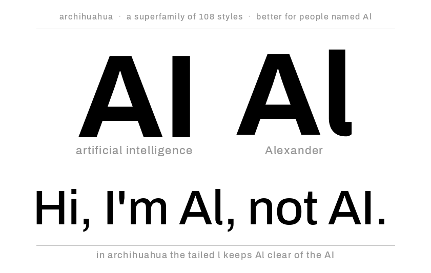
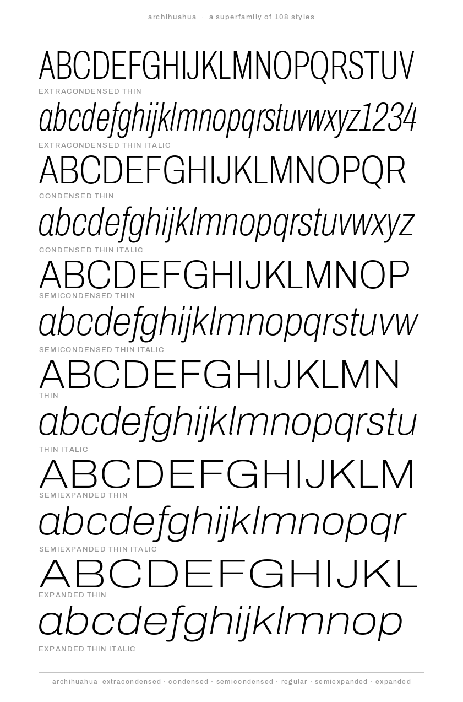
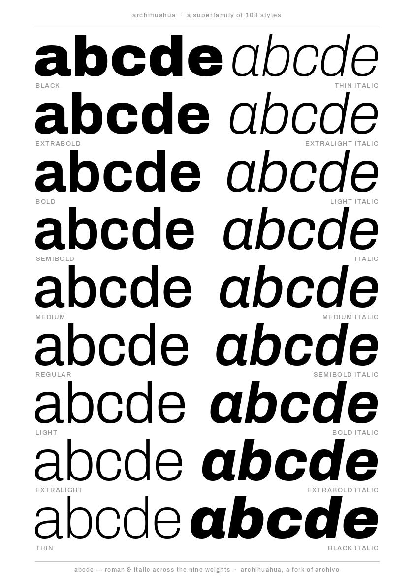

# Archihuahua

*SIL Open Font License, 1.1*

Archihuahua is a fork of [Archivo](https://github.com/Omnibus-Type/Archivo) by Omnibus-Type, with a little foot added to the lowercase **l** (the *l* has its dogs out 🐾).

  

### Designers

* Héctor Gatti (Archivo)
* Michael Stringer (Archihuahua modifications)

### License

Licensed under the [*SIL Open Font License, 1.1*](http://scripts.sil.org/OFL); you may not use this file except in compliance with the License.

### Acknowledgements

If you make modifications be sure to add your name (N), email (E), web-address
(if you have one) (W) and description (D). This list is in alphabetical order.

**N:** **Héctor Gatti**  
**E:** omnibus.type@gmail.com  
**W:** http://www.omnibus-type.com  
**D:** Designer

**N:** **Mike Stringer**  
**E:** mike.stringer.internet@gmail.com  
**D:** Tinkerer

**N:** **Yorlmar Campos**  
**E:** omnibus.type@gmail.com 
**W:** http://www.omnibus-type.com  
**D:** Typeface development 
